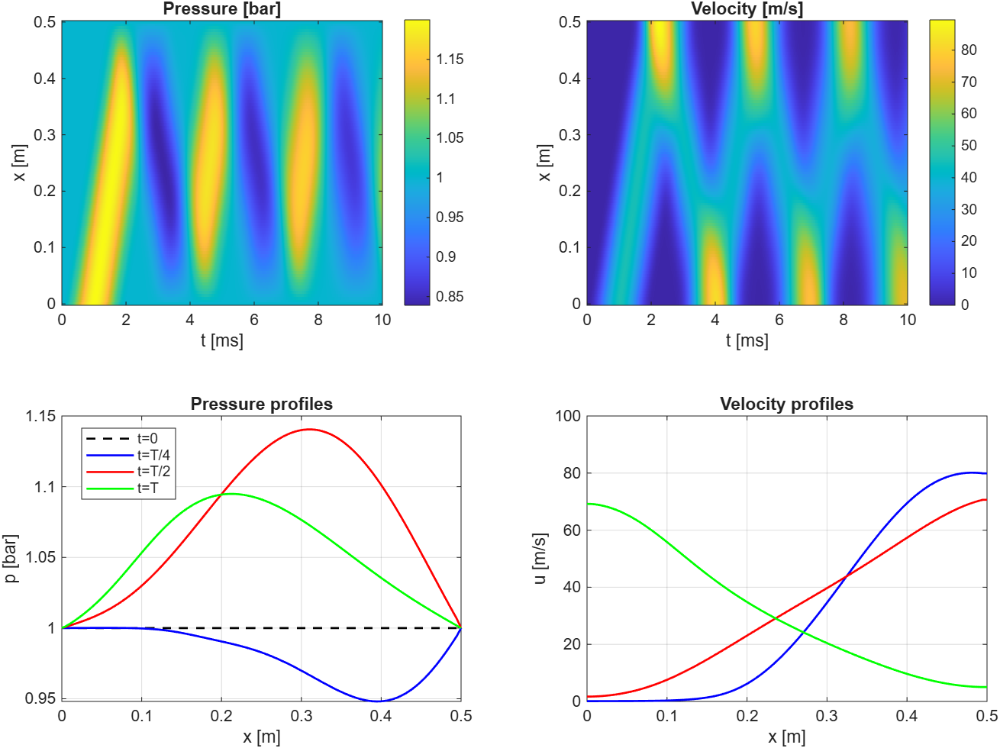

# Case 02 – Transient Pipe Flow


**File:** `02_transient_pipe_flow.m`  
**Key themes:** Transient gas flow, boundary conditions, heat transfer, mesh/solver mindset

---

## 1. What the simulation represents

A short pipe (length 0.5 m, diameter 5 cm) starts at rest (uniform pressure, temperature, zero velocity).  
At t = 0 a short pressure pulse is applied at the left end. The right end is held at constant ambient pressure.

We solve the 1-D unsteady Euler equations (compressible gas dynamics) with a simple wall heat-loss term.  
This is representative of transient flow inside a linear-generator duct.

---

## 2. Governing equations

The 1-D Euler equations in conservation form:

```
∂ρ/∂t       + ∂(ρu)/∂x           = 0
∂(ρu)/∂t    + ∂(ρu² + p)/∂x      = 0
∂E/∂t       + ∂[u(E + p)]/∂x     = Q_wall
```

where

```
E = ρ (e + ½ u²)          total energy per unit volume
e = cv * T                internal energy
p = ρ * R * T             ideal-gas law
```

Wall heat-loss source term (per unit volume):

```
Q_wall = – h_wall * (P_wall / A) * (T – T0)
```

---

## 3. Gas properties and geometry

```
gamma = 1.4
R     = 287 J/kg-K
cv    = R / (gamma – 1)
cp    = gamma * cv

L     = 0.5 m          pipe length
D     = 0.05 m         diameter
A     = π (D/2)²       cross-sectional area
Pwall = π D            wall perimeter
```

---

## 4. Grid and initial conditions

```
Nx = 100
dx = L / (Nx – 1)
x  = linspace(0, L, Nx)
```

Initial state (everything at rest):

```
p  = 1e5 Pa
T  = 300 K
u  = 0
ρ  = p / (R T)
```

---

## 5. Boundary forcing (left end)

A smooth sin² pressure pulse lasting 2 ms:

```
t_pulse = 0.002 s
dp      = 0.2e5 Pa          (+0.2 bar)

if t < t_pulse
    p_left = p0 + dp * sin(π t / t_pulse)²
else
    p_left = p0
end
```

- Starts at 0, rises smoothly to maximum at t = 1 ms, returns to 0 at t = 2 ms.
- No discontinuous jump in pressure or in its derivative.

Right end: pressure held fixed at ambient (p0).

Both ends are therefore **open (fixed-pressure) boundaries**.

---

## 6. Time-step control

```
c0  = sqrt(gamma * R * T0)     ≈ 347 m/s   (speed of sound)
CFL = 0.5
dt  = CFL * dx / (c0 + 50)     safety margin on maximum wave speed
Tfinal = 0.010 s               total simulation time = 10 ms
```

CFL ≤ 1 is required for stability of the explicit scheme.  
0.5 is a comfortable safety factor.

---

## 7. Numerical method (each time step)

### 7.1 Convert primitives → conservatives

```
mom = ρ * u
E   = ρ * (e + ½ u²)
```

### 7.2 Rusanov (local Lax–Friedrichs) numerical flux

At each interface i+½:

```
λ     = |u| + c
amax  = max(λ_i, λ_{i+1})

F_hat = ½ (F_L + F_R) – ½ amax (U_R – U_L)
```

where F are the physical fluxes of mass, momentum and energy.  
This is a simple, robust upwind flux. In production one would normally use HLLC or AUSM+.

### 7.3 Update interior points

```
ρ(2:end-1)   = ρ(2:end-1)   – dt * ∂Fρ/∂x
mom(2:end-1) = mom(2:end-1) – dt * ∂Fmom/∂x
E(2:end-1)   = E(2:end-1)   – dt * ∂FE/∂x
```

### 7.4 Add wall heat loss

```
Qdot = – h_wall * (Pwall / A) * (T – T0)
E    = E + dt * Qdot
```

### 7.5 Recover primitives

```
u = mom / ρ
e = E/ρ – ½ u²
T = e / cv
p = ρ * R * T
```

### 7.6 Apply boundary conditions

Left end:
- p and T prescribed (the pulse)
- ρ from ideal-gas law
- u copied from interior (zero-gradient approximation)

Right end:
- p and T fixed at ambient
- u copied from interior

---

## 8. Important physics note – why waves bounce even though ends are “open”

Fixed pressure ≠ non-reflecting.

| Boundary type               | Incident compression wave reflects as | Velocity at boundary |
|-----------------------------|---------------------------------------|----------------------|
| Solid wall (closed)         | Compression wave                      | Forced to 0          |
| Fixed pressure (open)       | Expansion wave                        | Free to be non-zero  |
| True non-reflecting BC      | Nothing (wave leaves)                 | —                    |

A fixed-pressure end still reflects acoustic waves; it simply changes a compression into an expansion (and vice versa).  
Only specially designed characteristic / absorbing boundary conditions let waves leave without reflection. Those are not used in this simple code.

Because both ends are open and the pulse is relatively weak, the velocity field stays ≥ 0 throughout the run.  
Mass is pushed in from the left and can leave through the right; the net flow remains positive.

---

## 9. What the four figures show

### Top-left: Pressure space-time contour (bar)
- Horizontal axis = time (0 → 10 ms)
- Vertical axis = distance along pipe (0 → 0.5 m)
- Diagonal bands of high (yellow) and low (dark blue) pressure show acoustic waves reflecting back and forth at roughly the speed of sound.

### Top-right: Velocity space-time contour (m/s)
- Colour scale from 0 to ~80 m/s (never negative in this run).
- High-velocity regions travel with the pressure waves.

### Bottom-left: Pressure profiles at selected times
- Black dashed = t = 0 (flat 1 bar)
- Blue = t = T/4
- Red = t = T/2
- Green = t = Tfinal

### Bottom-right: Velocity profiles at the same times
- All curves remain ≥ 0, consistent with open ends and a weak pulse.

---

## 10. Why the figure does not show a clean sin² shape

The contour plots show pressure *inside the whole pipe*, not the boundary value itself.  
As soon as the pulse enters the domain it begins to reflect; the plot quickly becomes a superposition of the original pulse plus multiple reflections.  
That turns the clean single bump into the series of diagonal bands.

To see the pure sin² forcing you would plot the left-boundary pressure history p(1,:) versus time.

---

